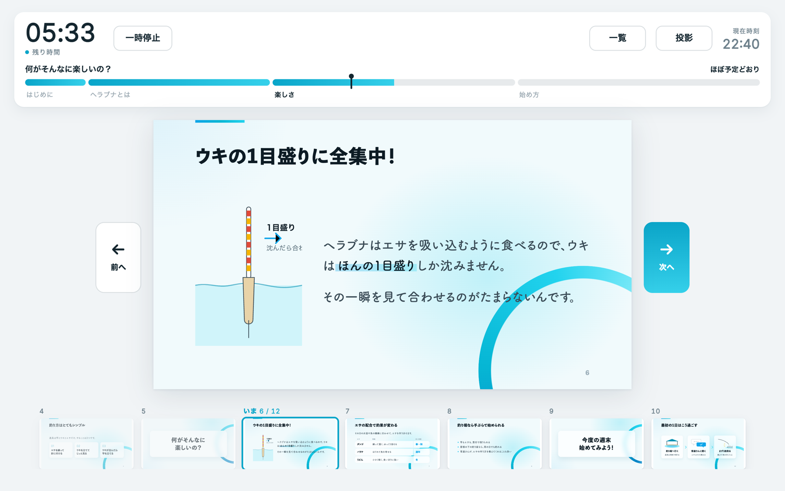

# パワポ映すマン

パワポ映すマンは、Marp で書いたスライドから、PowerPoint の代わりに投影できる発表用HTMLを書き出すスクリプトです。手元の操作画面で残り時間と進み具合を見ながら、もう1枚のディスプレイに投影画面を出せます。書き出すのは1つのHTMLファイルなので、ブラウザがあればどのPCからでも発表できます。

<p align="center">
  
</p>

## 主な機能

操作画面は全画面にしない普通の窓で、上から残り時間のパネル、今のページ、前後のページの帯の3段で並びます。窓を細くしてオンライン会議の画面の横に置いても、同じ並びで読めます。

持ち時間は残り時間の数字に直接打ち込み、Enter を押すとタイマーが始まります。進み具合のバーは、塗りがページの進み、針が時間の進みを表すので、針が塗りより先にいれば話が遅れているとすぐ分かります。

- 「投影」ボタン1回で、もう1枚のディスプレイいっぱいに投影画面の窓を出す
- 前後のページの帯を横スクロールでめくり、押したページに移動する
- 原稿の隣に置いたファイルで、進み具合のバーを3〜4つのパートに区切る

URL を開くと、最初は全ページを3列で並べた一覧になります。一覧からも操作画面に移ったり、投影を始めたりできます。

<p align="center">
  
</p>

## 入れ方

Claude Code にこのリポジトリの URL を渡して頼むのがいちばん簡単です。

> https://github.com/minorun365/presenter これ設定しといて

自分で入れる場合も、次の手順どおりに進めます。

## Claude Code 向けの設定手順

1. Python 3.10 以降と Node.js が入っているか、`python3 --version` と `node --version` で確かめます。どちらかがなければ、入れ方をユーザーに案内して止めます。
2. Marp CLI がなければ入れます。`marp --version` が通ればそれを使い、通らなければ `npm install -g @marp-team/marp-cli` を実行します。グローバルに入れられない環境では、スクリプトが `npx` 経由で呼ぶので、この手順は飛ばして大丈夫です。
3. このリポジトリを任意の場所に clone します。
4. 見本で動作を確かめます。

   ```bash
   python3 present.py example/deck.md --minutes 20 --open
   ```

   `OK` で始まる行が出て、ブラウザに操作画面が開けば完了です。
5. 下の「使い方」にある、自分の原稿で使うときのコマンドと、投影は Chrome で行うことをユーザーに伝えます。

## 使い方

Marp の原稿（.md）を渡すと、原稿の隣に `<名前>.present.html` を書き出します。

```bash
python3 present.py path/to/slides.md --minutes 30 --open
```

開いた操作画面で持ち時間を確かめ、「投影」を押します。ディスプレイが2枚あるときは、初回だけ Chrome に「ウィンドウの管理」の許可を求められるので許可してください。もう1枚のディスプレイに投影画面が出たら、どこもクリックせずに Enter を押すと全画面になり、そのあとのキー操作は操作画面に戻ります。

オンライン会議で画面を共有するときは、投影画面の窓を共有します。

オプション、パートの区切り方、テーマの指定、キー操作の詳細は [使い方の詳細](docs/usage.md) にまとめています。

## HTML共有くんと組み合わせる

書き出したHTMLは、画像を含めて原稿のフォルダ内で完結するので、静的ホスティングにフォルダごと置けば URL を開くだけで発表できます。同じ作者の [HTML共有くん](https://github.com/minorun365/html-share) に載せると、スマホで一覧を見返したり、出先のPCで共有くんを開いて投影したりできます。詳しくは [ホスティングして使う](docs/hosting.md) を参照してください。

## ドキュメント

- [使い方の詳細](docs/usage.md)
- [ホスティングして使う](docs/hosting.md)

## ライセンス

Apache License 2.0
