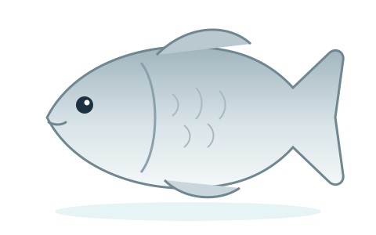
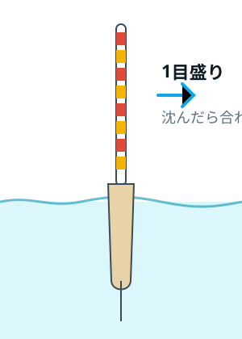
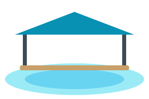
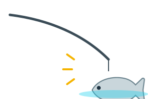

<!-- _class: top -->
<!-- _paginate: false -->

## 週末の趣味LT

# ヘラブナ釣りの 楽しさを 語らせてください

週末アングラー

---

<!-- _class: crosshead -->
<!-- _paginate: false -->

# ヘラブナ釣り 知ってますか？

---

# ヘラブナってどんな魚？

琵琶湖のゲンゴロウブナを、釣りのために改良したフナです。

全国の釣り堀や池で、<mark>釣ったら放す</mark>のが基本です。

---

# 釣り方はとてもシンプル

道具は竿とウキとエサだけ。やることは3つです。

<b>01</b>エサを練って 針に付ける

<b>02</b>ウキを立てて じっと見る

<b>03</b>ウキが沈んだら 竿を立てる

---

<!-- _class: crosshead -->
<!-- _paginate: false -->

# 何がそんなに 楽しいの？

---

# ウキの1目盛りに全集中！

ヘラブナはエサを吸い込むように食べるので、ウキは<mark>ほんの1目盛り</mark>しか沈みません。

その一瞬を見て合わせるのがたまらないんです。

---

# エサの配合で釣果が変わる

その日の水温や魚の機嫌に合わせて、エサを作り分けます。

| エサ | 特徴 | 向く時期 |
|---|---|---|
| ダンゴ | 練って重く、ゆっくり溶ける | 春〜秋 |
| バラケ | ほぐれて魚を寄せる | 通年 |
| うどん | 小さく軽く、食い渋りに強い | 冬 |

---

# 釣り堀なら手ぶらで始められる

- 竿もエサも、受付で借りられる
- 屋根の下の釣り座なら、雨の日でも釣れる
- 常連さんが、エサの作り方を教えてくれることも多い

---

<!-- _class: crosshead -->
<!-- _paginate: false -->

# 今度の週末 始めてみよう！

---

# 最初の1日はこう過ごす

<b>釣り堀へ行く</b>道具は現地で借りる

<b>常連さんに聞く</b>エサとタナを教わる

<b>まず1枚釣る</b>数より1枚の手ごたえ

---

# 上達のいちばんの近道

釣れた日も釣れなかった日も、エサの配合とウキの動きをメモしておきます。

<mark>同じ池に通うと、魚の機嫌が読めてくる</mark>

---

<!-- _class: end -->
<!-- _paginate: false -->

# Thank you!

週末アングラー
